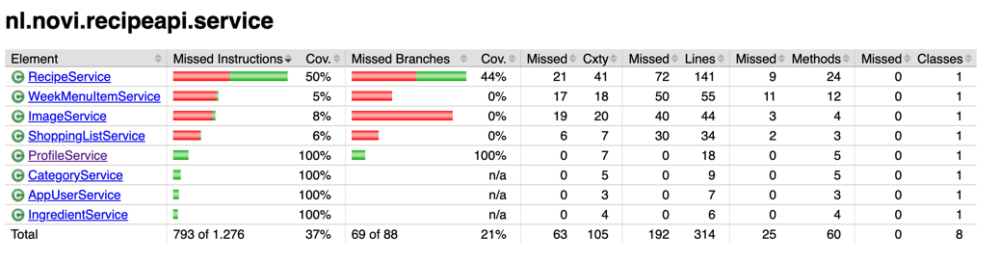

# Recipe API – Mijn Recepten

Dit project is ontwikkeld als backend-eindopdracht voor de opleiding Full Stack Developer bij NOVI Hogeschool.

De Recipe API is een REST API voor het beheren van recepten, ingrediënten, categorieën en weekmenu's. Gebruikers kunnen recepten bekijken en beheren, een persoonlijk weekmenu samenstellen en op basis daarvan een boodschappenlijst opvragen.

De applicatie is gebouwd met Java en Spring Boot. PostgreSQL wordt gebruikt voor het opslaan van gegevens en Keycloak verzorgt de authenticatie en autorisatie.

## 1. Functionaliteiten

De belangrijkste functionaliteiten zijn:

- Recepten ophalen, toevoegen, wijzigen en verwijderen.
- Recepten filteren op categorie.
- Ingrediënten en categorieën ophalen.
- Afbeeldingen uploaden en ophalen bij recepten.
- Gebruikersprofielen aanmaken en bekijken.
- Een persoonlijk weekmenu beheren.
- Een boodschappenlijst genereren op basis van een datumbereik.
- Toegang beveiligen met JWT-tokens en gebruikersrollen.

De API ondersteunt de rollen `USER` en `ADMIN`. Gebruikers kunnen hun eigen recepten beheren. Administrators hebben aanvullende rechten.

## 2. Gebruikte technologieën

| Technologie | Versie / toepassing |
|---|---|
| Java | 21 |
| Spring Boot | 4.0.8 |
| Maven | Dependency management en build |
| PostgreSQL | Relationele database |
| Spring Data JPA / Hibernate | Databasecommunicatie |
| Spring Security | Beveiliging van endpoints |
| Keycloak | Authenticatie en rollen |
| JUnit 5 en Mockito | Unit-tests |
| Spring Boot Test en MockMvc | Integratietests |
| H2 | Testdatabase |
| JaCoCo | Code coverage |
| Postman | API testen |

## 3. Benodigdheden

Zorg dat de volgende software is geïnstalleerd:

- Java JDK 21
- PostgreSQL
- Keycloak 26.4.0
- Postman
- Een IDE, bijvoorbeeld IntelliJ IDEA

Maven hoeft niet afzonderlijk geïnstalleerd te worden wanneer je de meegeleverde Maven Wrapper gebruikt.

## 4. Installatie

### 4.1 Project downloaden

Clone de GitHub-repository:

```bash
git clone https://github.com/MarlenaXXVII/recipe-api.git
cd recipe-api
```

Open vervolgens het project in IntelliJ IDEA en laat Maven de dependencies downloaden.

### 4.2 PostgreSQL configureren

Start PostgreSQL en maak een database aan met de naam:

```sql
CREATE DATABASE recipe_db;
```

De applicatie gebruikt standaard:

- Host: `localhost`
- Poort: `5433`
- Database: `recipe_db`

Controleer of PostgreSQL op deze poort draait. Pas anders de database-URL aan in `application.properties`.

### 4.3 Databasegegevens instellen

De applicatie leest de databasegebruikersnaam en het wachtwoord uit omgevingsvariabelen.

Stel de volgende variabelen in:

```text
DB_USERNAME=<jouw_postgresql_gebruikersnaam>
DB_PASSWORD=<jouw_postgresql_wachtwoord>
```
De gebruikersnaam en het wachtwoord moeten overeenkomen met de inloggegevens van de eigen PostgreSQL-installatie. Deze kunnen in IntelliJ IDEA worden ingesteld via Run → Edit Configurations → Environment variables. Maak hiervoor een Run Configuration aan voor de main class RecipeApiApplication.

De databaseverbinding is geconfigureerd in:

`src/main/resources/application.properties`

Bij het starten maakt Hibernate ontbrekende tabellen aan of werkt deze bij. Het bestand `data.sql` vult de database met voorbeeldgegevens, waaronder categorieën, ingrediënten, gebruikersprofielen en recepten.

### 4.4 Keycloak instellen

Start Keycloak op `http://localhost:8081`.

Importeer de meegeleverde Keycloak-export en controleer de volgende instellingen:

- Realm: `recipe-app`
- Client: `recipe-api`
- Rollen: `USER` en `ADMIN`

De API verwacht JWT-tokens die zijn uitgegeven door de realm `recipe-app`.

Controleer of de clientinstellingen, gebruikers en roltoewijzingen overeenkomen met de meegeleverde Keycloak-configuratie.

## 5. Applicatie starten

De applicatie kan worden gestart via IntelliJ IDEA.

1. Open het project in IntelliJ IDEA.
2. Wacht totdat Maven alle dependencies heeft geladen.
3. Ga naar **Run → Edit Configurations**.
4. Maak indien nodig een nieuwe Application Run Configuration aan met `RecipeApiApplication` als main class.
5. Stel de omgevingsvariabelen `DB_USERNAME` en `DB_PASSWORD` in met je eigen PostgreSQL-inloggegevens.
6. Selecteer de aangemaakte Run Configuration en klik op de groene **Run-knop** om de applicatie te starten.
Zorg ervoor dat PostgreSQL en Keycloak actief zijn voordat je de applicatie start.

Wanneer de applicatie succesvol is gestart, is de API bereikbaar via:

`http://localhost:8080`

Een voorbeeld van een openbaar endpoint is:

```http
GET http://localhost:8080/recipes
```

## 6. API testen met Postman

Bij de eindopdracht wordt een Postman-collectie meegeleverd met 21 requests.

1. Open Postman.
2. Importeer het meegeleverde JSON-bestand.
3. Controleer of het basisadres `http://localhost:8080` is ingesteld.
4. Haal via Keycloak een geldig JWT-token op voor een gebruiker of administrator.
5. Gebruik het token bij beveiligde endpoints via **Authorization → Bearer Token**.
6. Voer de gewenste requests uit.

Openbare GET-endpoints kunnen zonder token worden aangeroepen. Voor het beheren van recepten, profielen en weekmenu's is authenticatie vereist.

Voor alle endpoints, requestvoorbeelden, responses en HTTP-statuscodes wordt verwezen naar de apart meegeleverde API-documentatie.

## 7. Tests uitvoeren

De applicatie bevat unit-tests en integratietests.

De unit-tests controleren de logica in de servicelaag met behulp van JUnit en Mockito. Hierbij wordt eigen testdata gebruikt en worden de tests opgebouwd volgens Arrange, Act en Assert.

De integratietests controleren de samenwerking tussen verschillende onderdelen van de applicatie met Spring Boot Test en MockMvc.

### Alle tests uitvoeren

```bash
./mvnw clean test
```

### Tests uitvoeren en coverage genereren

```bash
./mvnw clean verify
```

Het JaCoCo-rapport is daarna te vinden op:

`target/site/jacoco/index.html`

De serviceklassen `ProfileService`, `CategoryService`, `AppUserService` en `IngredientService` behalen alle 4 100% line coverage.

## 8. Projectstructuur

De applicatie maakt gebruik van een gelaagde architectuur. Controllers verwerken HTTP-verzoeken, services bevatten de bedrijfslogica en repositories verzorgen de communicatie met de database.

## 9. Aanvullende documentatie

Bij de eindopdracht worden de volgende bestanden meegeleverd:

- Technisch ontwerp met user stories, eisen en UML-diagrammen.
- API-documentatie met endpointbeschrijvingen en voorbeelden.
- Postman-collectie (JSON).
- Keycloak-export (JSON).
- Verantwoordingsdocument.

Deze documenten geven aanvullende informatie over het ontwerp, de werking en de gemaakte keuzes binnen de applicatie.
test